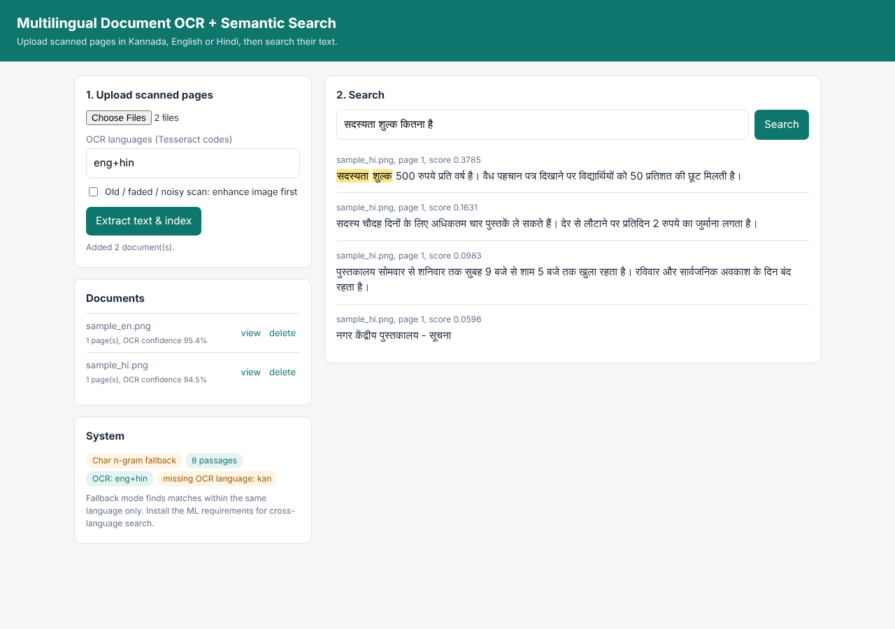

# Multilingual Document OCR + Semantic Search (Kannada / English / Hindi)

Upload scanned pages or PDFs, extract their text with OCR, and search the text with multilingual
embeddings and FAISS. Built for Indian-language documents, including old and degraded scans.



## Features
- **OCR pipeline** (Tesseract): skew correction, optional enhancement for faded/noisy scans
  (CLAHE, denoising, adaptive binarization), per-page confidence scores.
- **Scanned and text PDFs**: uses the PDF text layer when present, rasterizes and OCRs otherwise.
- **Two search backends**
  - `dense`: multilingual sentence embeddings (`intfloat/multilingual-e5-small`, ~100 languages
    including Kannada, Hindi, English) + **FAISS**. Supports **cross-language search**
    (e.g. an English question can retrieve a Hindi or Kannada passage).
  - `tfidf`: character n-gram TF-IDF. No model download, works offline, tolerant of OCR spelling
    errors, but only matches within the same language/script. Used automatically if the ML
    packages are not installed.
- **Web UI** (Flask): upload, view extracted text, search with highlighted results, delete.
- Sentence-aware chunking that understands the Devanagari danda (।).

## Quick start

### 1. Install Tesseract OCR with Kannada and Hindi
- **Windows:** install the UB Mannheim build (https://github.com/UB-Mannheim/tesseract/wiki).
  In the installer, under *Additional language data*, tick **Kannada**, **Hindi** and English.
  If `tesseract` is not on PATH, set `TESSERACT_CMD`, e.g.
  `set TESSERACT_CMD=C:\Program Files\Tesseract-OCR\tesseract.exe`
- **Ubuntu/Debian:** `sudo apt install tesseract-ocr tesseract-ocr-kan tesseract-ocr-hin tesseract-ocr-eng poppler-utils`
- **macOS:** `brew install tesseract tesseract-lang poppler`

For scanned **PDFs** you also need Poppler (Windows: https://github.com/oschwartz10612/poppler-windows,
then add its `bin` folder to PATH or set `POPPLER_PATH`).

### 2. Install Python packages
```
pip install -r requirements.txt            # core: OCR + char n-gram search
pip install -r requirements-ml.txt         # optional: embeddings + FAISS (cross-language search)
```

### 3. Run
```
python app.py
```
Open http://127.0.0.1:5000, upload the pages in `samples/`, and search, for example
`membership fee`, or in Hindi `सदस्यता शुल्क कितना है`.

The first run with the ML packages downloads the embedding model (~470 MB) once.

## Configuration (environment variables)
| Variable | Default | Meaning |
|---|---|---|
| `OCR_LANGS` | `kan+eng+hin` | Tesseract languages (only installed ones are used) |
| `SEARCH_BACKEND` | `auto` | `auto`, `dense`, or `tfidf` |
| `DENSE_MODEL` | `intfloat/multilingual-e5-small` | Any sentence-transformers model, e.g. `BAAI/bge-m3` |
| `TESSERACT_CMD` / `POPPLER_PATH` | (PATH) | Locations on Windows |
| `DATA_DIR` | `./data` | Where uploads, text and index are stored |

## How it works
```
image / PDF ──► preprocess (deskew, CLAHE, denoise, binarize*) ──► Tesseract (kan+eng+hin)
            ──► page text + confidence ──► sentence-aware chunks (~300 chars)
            ──► embeddings (e5) ──► FAISS index ──► top-k passages with scores
                                   (* only with "enhance" ticked)
```
Files: `ocr.py` (OCR), `search.py` (chunking, embeddings, FAISS / TF-IDF), `app.py` (Flask API),
`templates/index.html` (UI), `tests/test_pipeline.py` (end-to-end tests).

## API
| Endpoint | Description |
|---|---|
| `POST /api/upload` | form fields: `files`, `langs`, `enhance` |
| `GET /api/search?q=...&k=5` | ranked passages |
| `GET /api/docs/<id>` / `DELETE /api/docs/<id>` | view / remove a document |
| `GET /api/status` | backend, OCR languages, documents |

## Tests
```
python tests/test_pipeline.py
```
Checks OCR accuracy (English, Hindi), a skewed and noisy scan, scanned-page search in two
languages, index persistence and the web API. It uses the TF-IDF backend, so it needs no model
download. To test Kannada, add your own page as `samples/sample_kn.png` and install the `kan`
Tesseract language; the test then runs automatically.

## Known limitations
- OCR quality depends on the scan. Tesseract's Kannada model works on printed text; it is **not**
  trained for handwriting or weathered stone/ancient scripts. Those need a specialised model.
- TF-IDF mode cannot match across languages. Use the dense backend for that.
- Cross-language retrieval quality for Kannada depends on the embedding model; evaluate it on your
  own documents before relying on it.
- The in-memory index suits thousands of pages, not millions.

## License
MIT. See `LICENSE`.
